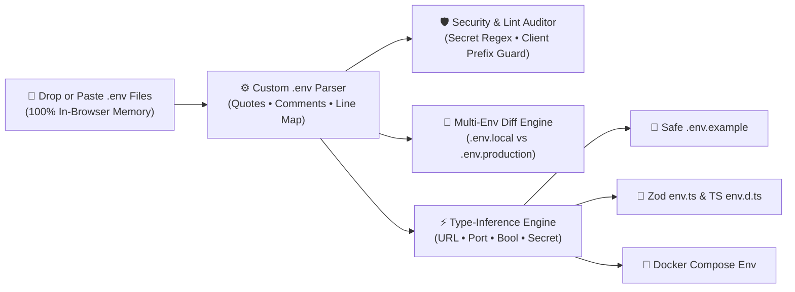

<div align="center">

<h1>🛡️ EnvGuard Studio</h1>

<h3>100% Local-First <code>.env</code> Secrets Auditor, Multi-Env Diff Checker &amp; Type-Safe Schema Generator</h3>

<p>
  <em>Catch leaked API keys, block <code>VITE_</code> &amp; <code>NEXT_PUBLIC_</code> client-bundle exposures, diff <code>.env.local</code> vs <code>.env.production</code>, sanitize <code>.env.example</code>, and generate Zod &amp; TypeScript schemas — completely offline in your browser.</em>
</p>

<p>
  
  
  
  
  
</p>

<p>
  <a href="https://github.com/a1n2a3s6/envguard-studio/stargazers">
    
  </a>
  <a href="https://github.com/a1n2a3s6/envguard-studio/network/members">
    
  </a>
  
</p>

<p>
  <a href="https://envguard-studio.vercel.app/"><strong>🚀 Live Demo</strong></a> &nbsp;•&nbsp;
  <a href="#-why-envguard-studio"><strong>🎯 Why EnvGuard</strong></a> &nbsp;•&nbsp;
  <a href="#-key-features"><strong>✨ Features</strong></a> &nbsp;•&nbsp;
  <a href="#-architecture"><strong>🏗️ Architecture</strong></a> &nbsp;•&nbsp;
  <a href="#-quick-start"><strong>⚡ Quick Start</strong></a> &nbsp;•&nbsp;
  <a href="#-one-click-deploy"><strong>☁️ Deploy</strong></a>
</p>

</div>

---

## 🎯 Why EnvGuard Studio?

Every developer has been burned by `.env` files at least once:

- **Silent Client Leaks:** Accidentally prefixing a secret key with `NEXT_PUBLIC_` or `VITE_` and shipping it straight into the public browser bundle.
- **Broken Production Deploys:** Pushing code to Vercel or Docker only to crash at runtime because a key in `.env.local` was missing from `.env.production`.
- **Tedious Manual Scrubbing:** Wasting 20 minutes manually stripping credentials to update `.env.example` or hand-writing Zod & TypeScript validation schemas.

> **🔒 Zero-Network Guarantee:** EnvGuard Studio runs **100% locally in your browser's memory**. Zero servers, zero telemetry, zero network requests — your secrets never leave your machine.

| Capability | 🛡️ EnvGuard Studio | Manual `.env` Workflow |
| :--- | :---: | :---: |
| **Detects Leaked AWS / Stripe / OpenAI / GitHub / DB Secrets** | ✅ Instant | ❌ Easy to miss |
| **Catches `VITE_` & `NEXT_PUBLIC_` Client Exposure Bugs** | ✅ Automatic | ❌ Silent leak |
| **Side-by-Side `.env.local` vs `.env.production` Diff** | ✅ Visual | ❌ Error-prone |
| **1-Click Safe `.env.example` Sanitizer (Preserves Comments)** | ✅ Instant | ❌ Manual scrubbing |
| **Auto-Generates Zod (`env.ts`), TS (`env.d.ts`) & Docker Env** | ✅ 1-Click | ❌ Repetitive boilerplate |
| **Screen-Share Secret Masking (Blur Values)** | ✅ Built-in | ❌ Risky on calls |

---

## ✨ Key Features

<table>
  <tr>
    <td width="50%" valign="top">
      <h3>🚨 Deep Secret &amp; Leak Auditor</h3>
      <p>Scans for real-world credential patterns (OpenAI, Stripe, AWS, GitHub, Slack, JWTs, DB URLs with passwords) and flags critical <code>NEXT_PUBLIC_</code> / <code>VITE_</code> exposure risks with an instant <b>0–100 Health Score</b>.</p>
    </td>
    <td width="50%" valign="top">
      <h3>🔀 Multi-Environment Diff Engine</h3>
      <p>Compare <code>.env.local</code> against <code>.env.production</code> or <code>.env.example</code> side-by-side to catch missing production variables, empty values, and shadowed duplicate keys before deploying.</p>
    </td>
  </tr>
  <tr>
    <td width="50%" valign="top">
      <h3>🧼 Smart <code>.env.example</code> Sanitizer</h3>
      <p>Automatically strips sensitive values into clean descriptive placeholders (e.g. <code>YOUR_STRIPE_SECRET_KEY</code>) while preserving all comments, section headers, and safe defaults like <code>PORT</code>.</p>
    </td>
    <td width="50%" valign="top">
      <h3>⚡ Type-Safe Code Generators</h3>
      <p>Infers variable types (URL, Port, Number, Boolean, Email, Secret) and generates copy-ready <b>Zod schemas</b>, <b>TypeScript <code>env.d.ts</code></b>, and <b>Docker Compose</b> env blocks.</p>
    </td>
  </tr>
  <tr>
    <td width="50%" valign="top">
      <h3>👁️ Screen-Share Secret Masking</h3>
      <p>Toggle <b>Mask Secrets</b> in one click to blur sensitive values directly in the editor — ideal for live demos, pair programming, and screen recordings.</p>
    </td>
    <td width="50%" valign="top">
      <h3>🔒 100% Offline Privacy</h3>
      <p>Disconnect your Wi-Fi and EnvGuard Studio keeps working identically. All parsing, auditing, diffing, and code generation execute purely in client-side TypeScript.</p>
    </td>
  </tr>
</table>

---

## 🔍 Built-In Security & Lint Rules

| Severity | Rule | What It Catches |
| :---: | :--- | :--- |
| 🔴 **Critical** | `SECRET_PATTERN` | Live OpenAI (`sk-...`), Stripe (`sk_live_...`), AWS (`AKIA...`), GitHub (`ghp_...`), Slack, JWTs & DB passwords |
| 🔴 **Critical** | `CLIENT_EXPOSURE` | Secret/token/password keys prefixed with `VITE_`, `NEXT_PUBLIC_`, or `REACT_APP_` |
| 🟡 **Warning** | `DUPLICATE_KEY` | Repeated keys in the same `.env` file silently overriding earlier values |
| 🟡 **Warning** | `SYNTAX_HAZARD` | Unquoted values with spaces, trailing whitespace, or empty required keys |
| 🔵 **Info** | `NAMING_HYGIENE` | Lowercase keys or insecure `http://` URLs inside production-named variables |

---

## 🏗️ Architecture



---

## 📂 Project Structure

<details>
<summary><b>Click to expand modular folder structure</b></summary>

```text
envguard-studio/
├── src/
│   ├── types/
│   │   └── env.ts              # Strict TypeScript domain models
│   ├── engine/
│   │   ├── parser.ts           # Line-accurate .env parser
│   │   ├── auditor.ts          # Secret detector, client-prefix guard & linter
│   │   ├── differ.ts           # Two-environment comparison engine
│   │   └── generators.ts       # .env.example, Zod, TS env.d.ts & Docker codegen
│   ├── components/
│   │   ├── Header.tsx          # Brand bar, Offline Privacy badge & Sample loader
│   │   ├── EnvEditor.tsx       # Drag-and-drop editor with Secret Masking toggle
│   │   ├── AuditPanel.tsx      # 0–100 Health Gauge & actionable issue cards
│   │   ├── DiffPanel.tsx       # Side-by-side missing/changed key inspector
│   │   └── ExportPanel.tsx     # Tabbed code output with Copy & Download
│   ├── App.tsx
│   ├── main.tsx
│   └── index.css
├── index.html
├── package.json
├── tsconfig.json
└── vite.config.ts
```

</details>

---

## ⚡ Quick Start

```bash
# 1. Clone the repository
git clone [https://github.com/a1n2a3s6/envguard-studio.git](https://github.com/a1n2a3s6/envguard-studio.git)

# 2. Enter the project directory
cd envguard-studio

# 3. Install dependencies
npm install

# 4. Launch the development server
npm run dev
```

---

## ☁️ One-Click Deploy

Deploy your own private instance of **EnvGuard Studio** to Vercel in under 60 seconds:

<p>
  <a href="https://vercel.com/new/clone?repository-url=https://github.com/a1n2a3s6/envguard-studio">
    
  </a>
</p>

---

## 🗺️ Roadmap

- [x] Real-time secret leak detection (AWS, Stripe, OpenAI, GitHub, Slack, JWT, DB URLs)
- [x] `NEXT_PUBLIC_` / `VITE_` / `REACT_APP_` client-bundle leak guard
- [x] Side-by-side multi-environment diff checker
- [x] Safe `.env.example`, Zod, TypeScript `env.d.ts`, and Docker Compose generators
- [ ] Shannon entropy scanner for unknown high-entropy API tokens
- [ ] Export to Vercel CLI & GitHub Actions Secrets format
- [ ] Companion `npx envguard check` CLI package

---

## 📄 License

Distributed under the **MIT License**. Free to use, modify, and self-host.

---

<div align="center">

<h3>👨‍💻 Author &amp; Connect</h3>

<p>Built with passion by <strong>Anas Alhelaly</strong> — <em>Day 8 of my <strong>365 Projects in 365 Days</strong> GitHub Challenge</em></p>

<p>
  <a href="https://anas-alhelaly.vercel.app/">
    
  </a>
  <a href="https://github.com/a1n2a3s6">
    
  </a>
  <a href="https://www.instagram.com/anas.alhelaly/">
    
  </a>
</p>

<p>⭐ <strong>If EnvGuard Studio saved you from a <code>.env</code> bug or leaked key, consider giving the repo a Star!</strong> ⭐</p>

</div>
